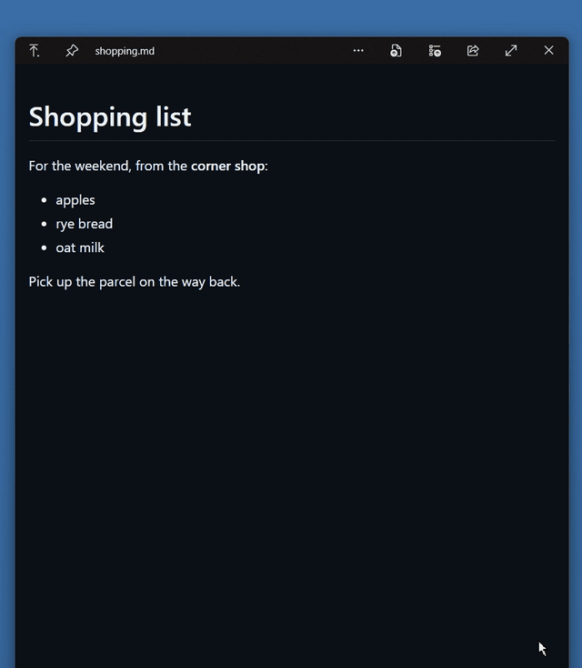

# QuickLook.Plugin.QuickEdit

Change a few words of a Markdown or plain text file right in its [QuickLook](https://github.com/QL-Win/QuickLook) preview: double-click, type, <kbd>Ctrl</kbd>+<kbd>S</kbd>. No editor opens.

<!-- Recording: save it as docs/quickedit.gif (under 5 MB), then uncomment the next line. -->
<!-- <p align="center"></p> -->

**Why:** QuickLook previews are read-only, so fixing one typo you spot in a preview means opening the file in an editor, finding the spot again, and closing it.

Made with Claude.

## Install

1. Download `QuickLook.Plugin.QuickEdit.qlplugin` from the [latest release](../../releases/latest).
2. Select it in Explorer and press <kbd>Space</kbd> to preview it with QuickLook.
3. Click **Install**, then restart QuickLook.

## Use

### Markdown files

- **Double-click** any rendered text (a paragraph, heading, list item, table cell, quote or code block) and type. Double-clicking a word selects it, so typing replaces it.
- **Enter** or clicking elsewhere finishes the edit. **Esc** cancels it.
- **Enter at the end of a bullet** starts a new bullet below it, with the same indent and marker (numbered lists count on). Press Enter on the empty new bullet to stop. **Enter at the end of a paragraph or heading** starts a new paragraph.
- **Delete all of a bullet's, paragraph's or heading's text** and press Enter or Backspace, and its lines are removed from the file.
- **Ctrl+B / Ctrl+I** make the selected text, or the word at the caret, bold or italic. Press again to remove it. This also works on text selected with the mouse, without double-clicking first.
- **Ctrl+S** writes the file. Nothing is saved unless you press it: close the preview and unsaved changes are gone.
- **Ctrl+Z** / **Ctrl+Y** undo and redo finished edits. While editing, Ctrl+Z undoes typing as usual.
- A small note in the corner says when there are unsaved changes.

The preview is still QuickLook's own Markdown viewer, with its table of contents, highlighting and diagrams; the plugin only adds editing to it. Space, Esc and the arrow keys work as usual whenever you aren't typing.

### Plain text files

Files QuickLook shows in its text viewer (`.txt`, `.json`, `.ps1`, `.py`, `.ini`, logs and so on) can be edited too.

- **Double-click** to start editing. The word you clicked is selected, so typing replaces it. From then on it behaves like a normal text editor: Enter adds a line and Ctrl+Z undoes.
- **Ctrl+S** saves and stops editing. **Esc** stops editing and keeps your changes, unsaved; press Esc again to close the preview, which discards them.
- The title bar shows whether you're editing or have unsaved changes.

Saving keeps the file's encoding and line endings. Files the viewer shows differently from what's on disk can't be edited: over 5 MB (it shows only the first 5 MB), or converted for display.

<details>
<summary><b>How an edit reaches the file</b></summary>

You edit the rendered text, but the plugin saves Markdown source. It works out the source change like this:

1. Each rendered block is matched to the source lines it came from.
2. The plugin generates candidate source changes for what you typed and renders each one.
3. It keeps the first candidate that renders to exactly the text you typed and keeps the formatting around it. For example, renaming the bold word in `Most **subfolders** are` writes `Most **folders** are`.

If no candidate fits, the edit is undone and the corner note says so. The plugin never guesses. Characters that Markdown would treat as formatting, such as `*` and `#`, are saved escaped (for example `\*`), so they show up as typed.

Saving keeps the file's encoding and its line endings (CRLF or LF, line by line). If the file changed on disk after the preview opened, the plugin refuses to save.

</details>

## Build

No .NET SDK needed. `build.ps1` compiles with the C# compiler that ships with the .NET Framework, against your installed QuickLook's `QuickLook.Common.dll`, and writes `dist\QuickLook.Plugin.QuickEdit.qlplugin`.

```powershell
.\build.ps1                              # Microsoft Store QuickLook
.\build.ps1 -QuickLookDir D:\QuickLook   # portable QuickLook
.\build.ps1 -Install                     # also install it (exit QuickLook first)
```

`QuickEdit.js` is the editing code that runs in the preview page. `Plugin.cs` adds that script to each Markdown preview, reads and writes the file, and keeps QuickLook's keyboard shortcuts out of the way while you type.

## Caveats

- QuickLook internals are reached by reflection: `ViewWindowManager._viewerWindow`, `ViewerWindow._path` and `ContextObject`, `WebpagePanel._webView`, `KeystrokeDispatcher._lastInvalidKeyPressTick`. A QuickLook release that renames one of these turns that part off, and QuickLook's log says which. Tested on QuickLook 4.5.0.
- A block containing math or a Mermaid diagram can't be edited.
- Markdown editing covers `.md`, `.markdown` and the other extensions QuickLook's Markdown viewer reads, except `.mermaid` and `.mmd`. Text editing needs QuickLook's text viewer (`TextViewerPanel`).
- In a plain text file, the second Esc (the one that closes the preview) is ignored if it comes within about half a second of the Esc that stopped editing. Press it again.

## Licence

GPL-3.0, the same as QuickLook. See [LICENSE](LICENSE).
